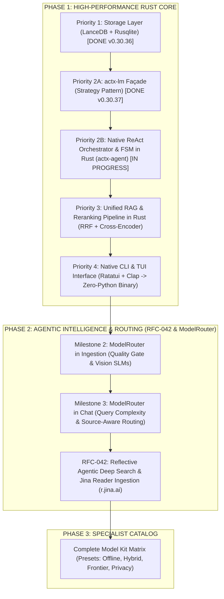

# 🗺️ Integrated Engineering Roadmap (Python -> Rust -> RFC-042 Deep Search -> ModelRouter -> Model Kit)

## 📌 Plan Metadata
- **Project**: AnyContext (`actx`)
- **Base Version**: `v0.30.38` (successor of `v0.30.37`)
- **Approval Date**: 2026-09-25
- **Status**: Active (`active`)
- **Conversation ID**: `9f488dbf-db54-4ecb-8ed2-b7a6ac1b2372`
- **Reference Specifications**: RFC-042 (`Architectural Evolution Specification.docx`), `actx-lm` RFC-041.

---

## 🏛️ Overview and Architectural Topology

AnyContext's development follows a methodical transition without compatibility breaks in **3 Strategic Phases**, making sure the Core is 100% native Rust before expanding routing and deep search intelligence:

---

## 🚀 PHASE 1: Python $\rightarrow$ Rust Refactoring (Performance Foundations)

### 1.1. Priority 1: Native Storage Layer in Rust (LanceDB + Rusqlite)
* **Status**: 🟢 **DONE** (delivered in version `v0.30.36`)
* **Deliverables**:
  - `NativeLanceStore` in `crates/any-context-core-rs/src/storage/lancedb.rs`.
  - Cosine vector search and metadata storage without Python intermediaries.
  - Type serialization bugs on Windows removed.

### 1.2. Priority 2A: Native Language Model Façade (`actx-lm`)
* **Status**: 🟢 **DONE** (delivered in version `v0.30.37`)
* **Deliverables**:
  - New independent crate [`crates/actx-lm`](file:///C:/Users/guilh/source/repos/any-context/crates/actx-lm) without heavy frameworks (no LangChain/LlamaIndex).
  - Strategy (`LmProvider`) and Façade (`LmClient`) patterns.
  - Full support for OpenAI, Anthropic, Gemini, Mock and local SLMs (`OpenAiCompatibleProvider` for Ollama and LM Studio at `http://localhost:11434/v1`).
  - Zero-copy SSE decoder and PyO3 bindings (`PyLmClient`).

### 1.3. Priority 2B: ReAct Orchestrator and Agent Loop in Rust (`actx-agent`)
* **Status**: ⚡ **IN PROGRESS / ACTIVE BLUEPRINT**
* **What to do**:
  1. **New Decoupled Crate `crates/actx-agent`**:
     - Native ReAct Finite State Machine (FSM): `CallModel` $\rightarrow$ `ExecuteTools` $\rightarrow$ `CheckBudget` $\rightarrow$ `Finished`.
     - Complete purge of the LangGraph / LangChain dependency in Python.
     - Deterministic anti-recursion protection (`max_turns: 10`), removing the `Recursion limit of 50 reached` error.
  2. **Universal Tool Catalog (`ToolRegistry`)**:
     - Polymorphic support for `NativeTool` (direct search in Rust memory without crossing the bridge) and `DynamicPyTool` (asynchronous PyO3 callbacks).
     - Foundation for MCP (*Model Context Protocol*) tools.
     - Defensive tool execution with self-recovery from JSON validation errors (`jsonschema`).
  3. **Clean Session Persistence (`SessionStore`)**:
     - Native SQLite storage with pure JSON history, without corruptible zlib compression.
  4. **Architectural Preparation for RFC-042**:
     - Support for several agent modes (`AgentExecutionMode::Direct`, `AgentExecutionMode::ReAct`, `AgentExecutionMode::DeepSearch`).
     - Rich event types in `AgentEvent` to render the `<DeepSearchTree />` in the terminal.

### 1.4. Priority 3: Native RAG and Reranking Pipeline in Rust
* **Status**: 🔴 **TO DO**
* **What to do**:
  1. **Zero-Copy In-Memory Fusion**: run the dense vector search (`NativeLanceStore`) and the sparse lexical search (`bm25.rs`) inside the same Rust process.
  2. **High-Concurrency Batch Retrieval (RFC-042)**: implement `retrieve_hybrid_batch` with Rayon/Tokio to feed Deep Search's simultaneous sub-queries.
  3. **RRF & Cross-Encoder Reranker in Rust**: SIMD optimization for Reciprocal Rank Fusion ($k=60$) with SHA-256 hash deduplication.
  4. **Integrated Context Density Budgeting**: smart truncation and source-fair round-robin working directly in memory before handing the tokens to `actx-lm`.

### 1.5. Priority 4: 100% Native CLI & TUI Interface (Single Binary)
* **Status**: 🔴 **TO DO**
* **What to do**:
  1. **Native Terminal CLI**: interface built with `clap` (flag parsing) and `ratatui` + `crossterm` (fast interactive TUI).
  2. **Removal of the Python Runtime from the Distribution**: AnyContext ships as a single static executable (`actx.exe` / `actx`), using under 40MB of RAM and starting in `< 10ms`.

---

## 🎯 PHASE 2: Adaptive Routing & Deep Agentic Research (RFC-042)

### 2.1. Milestone 2: `ModelRouter` in Ingestion (Specialist SLMs & Quality Gate)
* **Status**: 🟡 **TO DO (foundations ready with actx-lm)**
* **What to do**:
  1. **`IngestionModelRouter` Module (`crates/any-context-core-rs/src/ingestion/router.rs`)**:
     - Evaluates the confidence of the 2D extraction from `pdf.rs`.
  2. **Structure Quality Gate**:
     - *Level 1 (Text/2D Geometry)*: success -> direct indexing.
     - *Level 2 (Tesseract OCR)*: sparse but purely alphanumeric text -> fast OCR.
     - *Level 3 (Vision SLM through actx-lm)*: if the document has diagrams/complex tables without recoverable tabular data, calls a local multimodal SLM (`qwen2-vl` or `minicpm-v` on LM Studio / Ollama).
  3. **Ingestion Validator**: rejects noisy chunks before indexing in LanceDB.

### 2.2. Milestone 3: `ModelRouter` in Chat (Dynamic Query & Source-Aware Routing)
* **Status**: 🔴 **TO DO**
* **What to do**:
  1. **Embedded Local Complexity Classifier (RFC-042 §4.1)**:
     - A compact encoder model (~25MB ONNX Runtime) running on the CPU with sub-15ms latency and zero tokens spent.
     - Classes: `FAST_RAG` (point queries, syntax, a file) vs `DEEP_SEARCH` (architecture, audit, multi-module correlation).
  2. **Dynamic Routing by Source Typology**:
     - Pure code (Rust, TS, Python) $\rightarrow$ routed to a code-specialized model.
     - Legal/business documentation $\rightarrow$ routed to a model with a long window and contextual reasoning.
  3. **Chat Slash Commands**:
     - `/fast <query>`: forces direct single-turn execution.
     - `/deep <query>`: forces the iterative agentic loop.
     - `/search <auto|fast|deep>`: sets the active workspace's policy in the SQLite database.

### 2.3. RFC-042: Reflective Agentic Deep Search Engine & Jina Reader Ingestion
* **Status**: 🔴 **TO DO (planned after Priority 3)**
* **What to do**:
  1. **5-Phase Reflective Cycle**:
     - *Phase 1 (Decomposition)*: decomposes complex questions into 2 to 4 structured orthogonal sub-queries (code, documentation, configuration).
     - *Phase 2 (Parallel Batch Search)*: runs `retrieve_hybrid_batch` concurrently in Rust through LanceDB + BM25 with SHA-256 deduplication.
     - *Phase 3 (Gap Evaluation)*: a reflection node that evaluates factual sufficiency, a ceiling of 2 iterations and diminishing returns ($>90\%$ overlap).
     - *Phase 4 (Surgical Re-generation)*: a search focused strictly on the identified blind spots.
     - *Phase 5 (Synthesis with Provenance)*: answer generation with mandatory file and line citations (`[src/auth/jwt.rs:45-60]`).
  2. **Reactive Terminal UX (<DeepSearchTree />)**:
     - Real-time rendering of the nested sub-task tree in Ink/React.
     - Auto-collapse after streaming into a minimalist one-line summary.
     - `Ctrl+O` shortcut to expand/collapse the full reflection history.
  3. **Jina Reader Web Connector (`r.jina.ai`)**:
     - Ingestion of modern SPAs through the `https://r.jina.ai/<url>` endpoint, converting heavy pages into pure Markdown with zero local RAM consumption (no headless Chromium).
     - Asynchronous local fallback through Crawl4AI for restricted/air-gapped environments.

---

## 🧩 PHASE 3: The Complete "Model Kit" Matrix (The Definitive Catalog)

* **Status**: 🔴 **TO DO (Final Stage)**
* **What to do**:
  - Implement configuration presets and environment auto-detection in AnyContext:
    1. **100% Offline / Edge Preset (Zero Cloud Dependency)**:
       - LLM/SLM: Ollama / LM Studio (`qwen2.5-coder:7b`, `llama-3.2-3b`, `phi-3.5`).
       - Embedding: native BGE-small-en in ONNX.
       - Reranker: local MiniLM Reranker ONNX.
    2. **Hybrid Preset (Balanced Cost/Benefit)**:
       - RAG / Preprocessing: local SLMs on the user's hardware.
       - Inference / Synthesis: DeepSeek-V3 or Claude 3.5 Haiku through an API.
    3. **Frontier / Power User Preset**:
       - Claude 3.5 Sonnet / GPT-4o for architectural synthesis and critical refactoring.
    4. **Maximum Corporate Privacy Preset**:
       - Exclusive connection to private vLLM or Azure OpenAI instances with data isolation.
