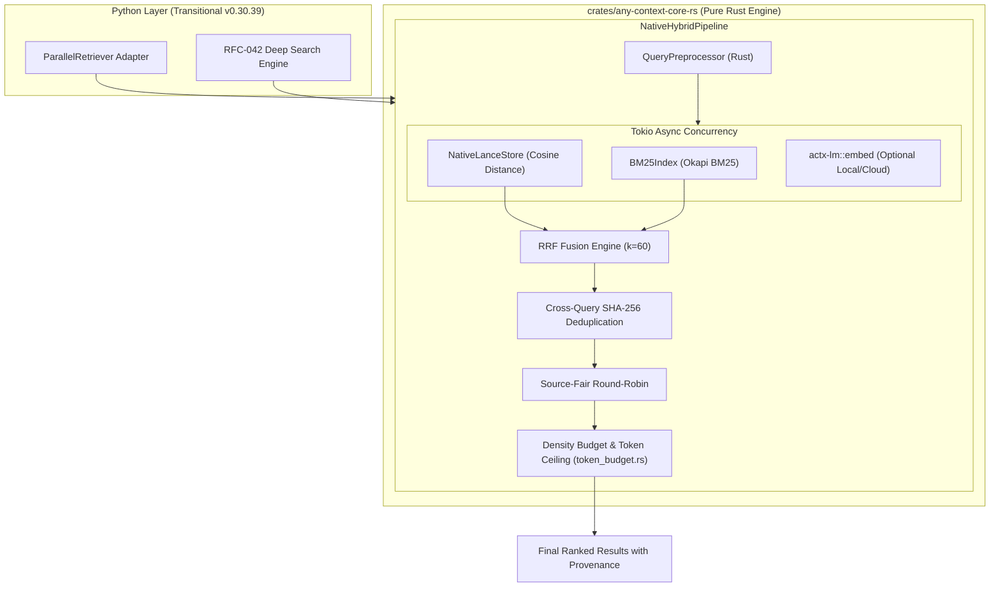

# 📐 Engineering Blueprint: Priority 3 - Native RAG and Reranking Pipeline in Rust (`NativeHybridPipeline` & `retrieve_hybrid_batch`)

> **Protocol**: `dev-cycle-protocol` v2.0  
> **Status**: Proposal for Gate 3 Approval  
> **Project**: AnyContext (`actx`)  
> **Target Version**: `v0.30.39`  
> **Long-Term Architecture Goal**: 100% Rust migration (zero lines of Python in the final binary).

---

## 1. Executive Summary & Problem Statement

### 1.1 Context and Current Problem
In the current AnyContext (`v0.30.38`), although dense vector search (`NativeLanceStore`) and sparse lexical search (`BM25Index`) have low-level Rust implementations, **the RAG pipeline orchestration is still managed in Python** (`ParallelRetriever` in `retriever.py`):
1. **GIL Bottleneck and Multiple PyO3 Boundary Crossings**: for each query, Python splits requests into a `ThreadPoolExecutor`, calls the Rust LanceDB, makes a separate call to the Rust BM25, serializes hundreds of candidate dictionaries into Python memory and sends them back to Rust for RRF fusion.
2. **No Native Batching for Deep Search (RFC-042)**: Deep Search Phase 2 requires running 2 to 4 orthogonal sub-queries simultaneously with cross-query SHA-256 hash deduplication. In Python, this would saturate the event loop with inefficient concurrency.
3. **Dependency on Heavy Python Libraries (LlamaIndex)**: embedding generation still depends on LlamaIndex adapters in Python, delaying the goal of removing the Python runtime entirely.

### 1.2 The Priority 3 Solution
Build the **`NativeHybridPipeline`** in pure Rust (`crates/any-context-core-rs/src/retrieval/pipeline.rs`), unifying dense search, sparse search, RRF fusion, SHA-256 deduplication, source-fair round-robin and density budgeting in a single high-speed pass with Tokio concurrency.

---

## 2. Architectural Design & Boundaries (Ports & Adapters)

The design strictly follows the hexagonal architecture with the fundamental **Rust-First Standalone** principle:
- All business logic, index synchronization, ranking, diversification and deduplication live in pure Rust.
- The PyO3 binding (`PyHybridPipeline`) acts **strictly as a temporary transition adapter** for the current AnyContext, so that in Priority 4 (100% Native CLI & TUI Interface in Rust) the pipeline is consumed directly by the single binary without any code change.



---

## 3. Component Breakdown & Data Structures

### 3.1 `HybridSearchRequest` & `HybridBatchResult` (`crates/any-context-core-rs/src/retrieval/pipeline.rs`)

```rust
#[derive(Debug, Clone, Serialize, Deserialize)]
pub struct HybridSearchRequest {
    pub sub_query_id: Option<String>,
    pub query_text: String,
    pub query_vector: Option<Vec<f32>>,
    pub workspace: String,
    pub target_workspaces: Vec<String>,
    pub top_k: usize,
    pub candidate_pool_k: usize,
    pub min_score: f32,
    pub max_chunks_per_source: usize,
    pub max_density_chars: usize,
    pub table_name: String,
}

#[derive(Debug, Clone, Serialize, Deserialize)]
pub struct HybridSearchResult {
    pub chunk_id: String,
    pub file_name: String,
    pub file_path: String,
    pub workspace: String,
    pub text: String,
    pub content_hash: String,
    pub rrf_score: f32,
    pub dense_score: Option<f32>,
    pub sparse_score: Option<f32>,
    pub token_count: usize,
    pub matched_subqueries: Vec<String>,
}
```

### 3.2 `NativeHybridPipeline`

```rust
pub struct NativeHybridPipeline {
    lance_store: Arc<NativeLanceStore>,
    bm25_indices: Arc<RwLock<HashMap<String, BM25Index>>>, // Workspace -> BM25
    lm_client: Option<Arc<dyn LmProvider>>,
}

impl NativeHybridPipeline {
    pub fn new(lance_store: Arc<NativeLanceStore>, lm_client: Option<Arc<dyn LmProvider>>) -> Self;
    
    /// Runs a single-query hybrid search in memory without GIL crossings
    pub async fn search(&self, req: HybridSearchRequest) -> Result<Vec<HybridSearchResult>, RetrievalError>;

    /// RFC-042: runs a concurrent batch of sub-queries with cross-query SHA-256 hash deduplication
    pub async fn retrieve_hybrid_batch(
        &self,
        requests: Vec<HybridSearchRequest>,
    ) -> Result<Vec<HybridSearchResult>, RetrievalError>;
}
```

---

## 4. Zero-Regression & Backward Compatibility Strategy

1. **Parity with Python**: `ParallelRetriever` in `src/any_context/vector_engine/retriever.py` delegates its calls directly to `NativeHybridPipeline` when the native module is present, preserving the exact return interface (`List[ScoredChunk]`).
2. **Dual Embedding Support**: if Python already computed the vector through a cache or LlamaIndex, it passes `query_vector = Some(...)`. Otherwise, Rust uses `actx-lm` to generate the vector internally.
3. **Inviolable Workspace Isolation**: LanceDB and BM25 queries keep strict per-workspace partitioning, preventing data leaks between workspaces.
4. **Non-Truncated Test Reserve**: the existing suite of 370 tests keeps running with 100% approval.

---

## 5. Security, Secret Hygiene & Integrity Validation

- **No Hardcoded Secrets**: no token or credential is persisted in code or artifacts. Embedding API keys are injected through `AppSettings` or secure environment variables.
- **Memory Limit Validation (OOM Defense)**: the native `Density Budgeter` enforces a hard ceiling of characters (`max_density_chars`) and tokens (`truncate_to_token_ceiling`), preventing LLM context buffer overflow.
- **SQL/LanceDB Identifier Sanitization**: full protection against parameter injection in metadata filter clauses.

---

## 6. Step-by-Step Implementation & Verification Plan

- [ ] **Step 1: `pipeline.rs` Module in `crates/any-context-core-rs`**:
  - Implement the `NativeHybridPipeline` struct with zero-copy LanceDB + BM25 fusion.
  - Implement cross-query SHA-256 hash deduplication, accumulating the RRF score.
- [ ] **Step 2: RFC-042 Batch Retrieval Algorithm (`retrieve_hybrid_batch`)**:
  - Concurrent execution of sub-query requests through `futures::future::join_all`.
- [ ] **Step 3: PyO3 Bindings (`PyHybridPipeline`)**:
  - Expose `PyHybridPipeline`, `PyHybridSearchRequest`, `PyHybridSearchResult` with the GIL released (`py.allow_threads`).
- [ ] **Step 4: Python Integration (`retriever.py`)**:
  - Update `ParallelRetriever` to connect to the native pipeline with a transparent fallback.
- [ ] **Step 5: Unit and Integration Tests**:
  - Rust tests in `crates/any-context-core-rs/tests/` for single and batch search.
  - Python tests in `tests/unit/core/test_native_rag_pipeline.py`.
  - Run the general runner `python tests/run_all_e2e.py` (370+ green tests).
- [ ] **Step 6: Dual-Doc & Manual Tests**:
  - Update `README.md`, `TECDOC.md` (Section 76) and `tests/MANUAL_TESTS.md` (Scenario 1 v0.30.39 without compaction).
- [ ] **Step 7: Gate 8 Verification & Release**:
  - `verify_gate.py --gate 8` approved.
  - Milestone updated in `plan-memory` through `check_milestone.py --milestone "Priority 3"`.

---

## 7. Dual-Doc Specification (UserDoc & TecDoc)

- **UserDoc (`README.md`)**: a section documenting the native RAG pipeline in Rust, sub-3ms performance for hybrid searches and the parallel search capability for Deep Search.
- **TecDoc (`TECDOC.md`)**: Section 76 documenting the mathematical architecture of RRF fusion with cross-query SHA-256 deduplication, and ADR-076 recording the replacement of the Python orchestration by the native Rust pipeline.

---

## 8. Rollback & Disaster Recovery Protocol

- If the native Rust pipeline fails in any edge case (e.g. a BM25 index not yet synced), `ParallelRetriever` in Python detects the error and runs the transparent fallback to the legacy retrieval method.
- No destructive change is made to the LanceDB schema or the SQLite `actx_settings.db` database.
