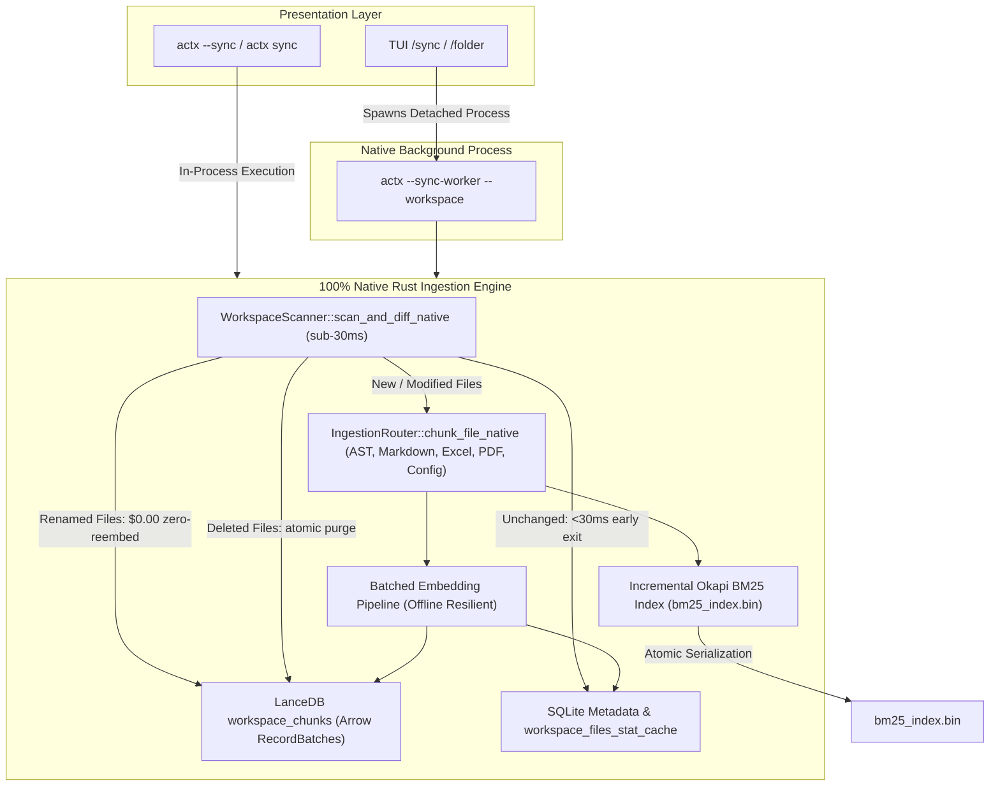

# 🦀 Engineering Blueprint: 100% Rust Transition (Zero Python Dependencies) & Release v0.32.19

## 📌 Plan Metadata
- **Project**: AnyContext
- **Title**: 100% Rust Transition: Native Ingestion and Sync Orchestrator (Zero Python Dependencies) & Release v0.32.19
- **Version**: `v0.32.19`
- **Session ID**: `780181b0-ddec-4d23-8650-af209e2a2fe3`
- **Execution Date**: 2026-10-08 / 2026-10-09
- **Status**: `COMPLETED`
- **Milestones**: M1: Stat Cache and Native Diff Scanner, M2: NativeSyncOrchestrator and IngestionRouter, M3: CLI and Background Worker, M4: Rust Test Suite (100% Pass), M5: Diagnosis and Fix of Path Separators in Windows CI, M6: Dual-Doc (TecDoc 98, ADR-105, Scenario 21), M7: Versioning and Publication of Tag v0.32.19

---

## 🎯 1. Context and Motivation
The previous architecture depended on Python subprocesses (`actx-core.exe`, PyInstaller bundles, `unified_sync.py`, `local_folder_ingestor.py`) for file ingestion and vector generation. This introduced:
1. A distribution payload overhead of ~380MB compressed and ~1.2GB on disk.
2. Cold-start latency of 1.5–3.0s per launch on Windows because of runtime extraction.
3. Divergent path handling and a risk of zombie process locks.
4. Duplicated logic between Python and Rust.

Version `v0.32.19` consolidates the transition to 100% native Rust in the ingestion and sync flow.

---

## 🏗️ 2. Implemented Architecture

### Key Components:
1. **`WorkspaceScanner::scan_and_diff_native`**:
   - Sub-30ms scanning with an SHA-256 and mtime cache in `workspace_files_stat_cache`.
   - Instant detection of renamed/moved files at $0.00 cost, without re-vectorization.
   - Canonical separators per OS (`\` on Windows, `/` on Unix).
2. **`IngestionRouter::chunk_file_native`**:
   - Structured AST chunking in 13 programming languages.
   - Hierarchical Markdown with contextual heading breadcrumbs.
   - Spreadsheets and financial data (.xlsx, .xls, .ods, .csv, .tsv, .ofx).
   - PDF documents and structured data (.json, .yaml, .toml, .xml).
3. **`NativeSyncOrchestrator`**:
   - Direct Arrow columnar insertion into the LanceDB `workspace_chunks` table.
   - Incremental update of the Okapi BM25 index and atomic write to `bm25_index.bin`.
   - Deterministic fallback vectors for offline resilience.
   - Instant cooperative cancellation through SQLite `workspace_sync_status`.
   - Native asynchronous web crawling through `reqwest`.
4. **CLI and Worker Integration**:
   - `--sync-worker` flag for decoupled background execution (`CREATE_NO_WINDOW` on Windows).
   - Graceful fallback to an in-process thread (`sync-worker-<ws>`).
   - CLI and TUI commands pointing exclusively to the native orchestrator.

---

## 🧪 3. Validation and Quality
- **Rust Test Suite**: 156 tests passing with 100% success (`cargo test --workspace`).
- **CI Resolution**: path separators adjusted in `scanner.rs` and `sqlite.rs`, removing the 6 failures on the GitHub Actions Windows runners.
- **Manual Script**: Scenario 21 added to `tests/MANUAL_TESTS.md`.
- **Dual-Doc**: Section 98 and ADR-105 added to `TECDOC.md`.
- **Release**: tag `v0.32.19` pushed and triggering workflows on GitHub Actions.
