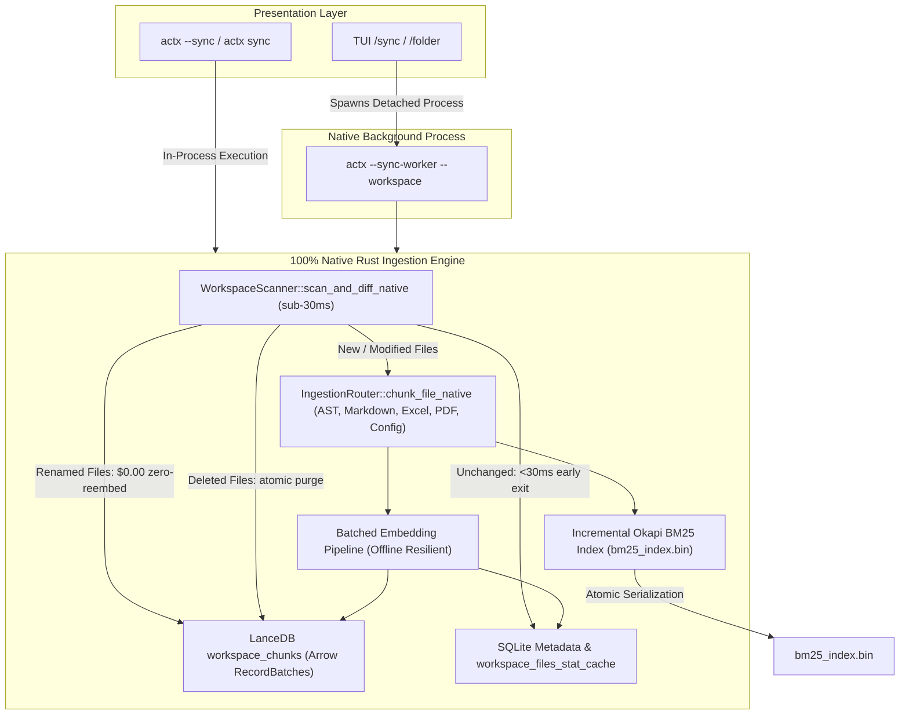

# 🦀 Blueprint de Engenharia: Transição 100% Rust (Zero Dependências Python) & Release v0.32.19

## 📌 Metadados do Plano
- **Projeto**: AnyContext
- **Título**: Transição 100% Rust: Orquestrador Nativo de Ingestão e Sincronização (Zero Dependências Python) & Release v0.32.19
- **Versão**: `v0.32.19`
- **Session ID**: `780181b0-ddec-4d23-8650-af209e2a2fe3`
- **Data de Execução**: 2026-10-08 / 2026-10-09
- **Status**: `COMPLETED`
- **Milestones**: M1: Stat Cache e Scanner Diff Nativo,M2: NativeSyncOrchestrator e IngestionRouter,M3: CLI e Worker em Background,M4: Suíte de Testes Rust (100% Pass),M5: Diagnóstico e Correção de Separadores de Caminho no CI Windows,M6: Dual-Doc (TecDoc 98, ADR-105, Cenário 21),M7: Versionamento e Publicação Tag v0.32.19

---

## 🎯 1. Contexto e Motivação
A arquitetura anterior dependia de subprocessos Python (`actx-core.exe`, PyInstaller bundles, `unified_sync.py`, `local_folder_ingestor.py`) para ingestão de arquivos e geração de vetores. Isso introduzia:
1. Overhead de payload de distribuição de ~380MB comprimido e ~1.2GB em disco.
2. Latência de cold-start de 1.5–3.0s por disparo no Windows devido à extração de runtime.
3. Divergência de manipulação de caminhos e risco de bloqueios de processos zumbis.
4. Duplicação de lógica entre Python e Rust.

A versão `v0.32.19` consolida a transição para Rust 100% Nativo no fluxo de ingestão e sincronização.

---

## 🏗️ 2. Arquitetura Implementada

### Componentes Chave:
1. **`WorkspaceScanner::scan_and_diff_native`**:
   - Escaneamento em sub-30ms com cache SHA-256 e mtime em `workspace_files_stat_cache`.
   - Detecção instantânea de arquivos renomeados/movidos a custo $0.00 sem re-vetorização.
   - Separadores canônicos por SO (`\` no Windows, `/` no Unix).
2. **`IngestionRouter::chunk_file_native`**:
   - Chunking AST estruturado em 13 linguagens de programação.
   - Markdown hierárquico com breadcrumbs de títulos contextuais.
   - Planilhas e dados financeiros (.xlsx, .xls, .ods, .csv, .tsv, .ofx).
   - Documentos PDF e dados estruturados (.json, .yaml, .toml, .xml).
3. **`NativeSyncOrchestrator`**:
   - Inserção colunar Arrow direta na tabela `workspace_chunks` do LanceDB.
   - Atualização incremental do índice Okapi BM25 e gravação atômica em `bm25_index.bin`.
   - Vetores determinísticos de fallback para resiliência offline.
   - Cancelamento cooperativo instantâneo via SQLite `workspace_sync_status`.
   - Crawling web assíncrono nativo via `reqwest`.
4. **Integração de CLI e Worker**:
   - Flag `--sync-worker` para execução desacoplada em background (`CREATE_NO_WINDOW` no Windows).
   - Fallback gracioso para thread em processo (`sync-worker-<ws>`).
   - Comandos CLI e TUI apontando exclusivamente para o orquestrador nativo.

---

## 🧪 3. Validação e Qualidade
- **Rust Test Suite**: 156 testes passando com 100% de sucesso (`cargo test --workspace`).
- **Resolução de CI**: Ajustados separadores de caminho em `scanner.rs` e `sqlite.rs` eliminando as 6 falhas nos runners Windows do GitHub Actions.
- **Roteiro Manual**: Cenário 21 adicionado em `tests/MANUAL_TESTS.md`.
- **Dual-Doc**: Seção 98 e ADR-105 adicionados em `TECDOC.md`.
- **Release**: Tag `v0.32.19` enviada e disparando workflows no GitHub Actions.
