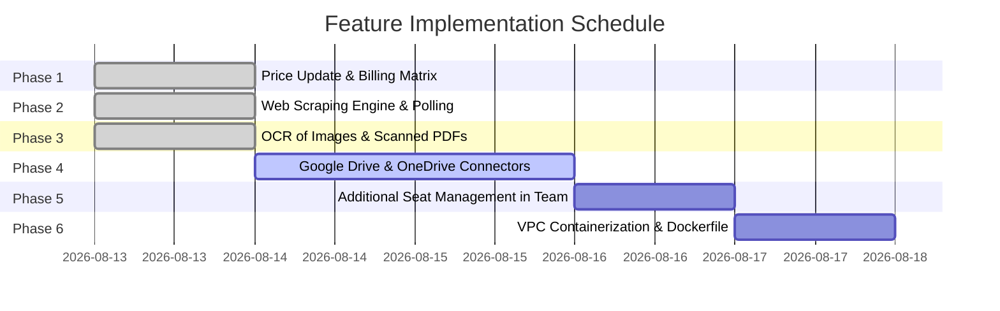

# 🚀 Implementation Plan: Modules and Features of the Subscription Plans

> **Goal**: Deliver 100% of the features needed to support the product line and the new affordable price table, focused on high conversion and per-user growth (*Expansion MRR*).

---

## 📊 1. Aligned Price and Feature Matrix

| **Plan** | **Monthly Price** | **Annual Price (-20%)** | **Scope & Features** | **Validation Rules in `BillingManager`** |
|---|---|---|---|---|
| **Community (Free)** | **$0** | **$0** | 1 Local Workspace (up to 3 local folders). | `max_workspaces=1`, `allowed_sources=["local"]`, `supports_ocr=False`. |
| **Personal / Starter** | **$12 /month** *(~CAD 15)* | **$9 /month** ($108/year) | Unlimited Local Workspaces + **OCR of Images and Scanned PDFs**. | `max_workspaces=999`, `allowed_sources=["local"]`, `supports_ocr=True`. |
| **Pro (Multi-Context)** | **$29 /month** *(~CAD 38)* | **$24 /month** ($288/year) | **Multi-Context**: Local Folders + Google Drive + OneDrive + Web Scraping + OCR. | `allowed_sources=["local", "drive", "web"]`, `supports_multi_context=True`. |
| **Team (Collaboration)** | **$79 /month** *(includes 5 seats)* + **$15/month** per additional seat | **$65 /month** ($780/year) + **$12/month** per extra seat | Everything in Pro + Multi-User (RBAC, Invitations, Shared Workspaces). | `base_seats=5`, `extra_seat_price_usd=15.00`, `supports_collaboration=True`. |
| **Enterprise (VPC / On-Prem)** | **$499 /month** or **$4,900/year** | On request | Docker containers in a Private VPC + SSO + Offline License + SLA Support. | `supports_custom_vpc=True`, `unlimited_seats=True`. |

---

## 🏗️ 2. Technical Detail of the Implementation Phases

### 📍 Phase 1: Schema and Price Matrix Update
- **Status**: ✅ **DONE**.

---

### 🌐 Phase 2: Web Scraping Engine & Recurring Polling
- **Status**: ✅ **DONE**.
- **Files**: `src/any_context/ingestion/web_ingestor.py`, `src/any_context/ingestion/web_scheduler.py`.

---

### 📷 Phase 3: Image Processing and OCR Daemon
- **Status**: ✅ **DONE**.
- **Files**: `src/any_context/ingestion/image_ocr_ingestor.py`.

---

### ☁️ Phase 4: Cloud Storage Connectors - Google Drive & OneDrive
- **Goal**: Allow OAuth2 login and incremental sync of Google Drive and Microsoft OneDrive folders.
- **New Files**:
  - `src/any_context/ingestion/gdrive_ingestor.py`: Google Drive API v3 integration client.
  - `src/any_context/ingestion/onedrive_ingestor.py`: Microsoft Graph API integration client.

---

### 👥 Phase 5: Additional Seat Management in the Team Plan
- **Goal**: Control the number of users registered in the SQLite database against the active license in the Team plan ($79 base + $15/extra seat).
- **Actions**:
  - Update `src/any_context/billing/store.py` with the `extra_seats_purchased` field.
  - Update `POST /v1/users` in the REST API to prevent creating users when the seat limit (5 base + extras) is reached without buying an additional $15/month seat.

---

### 🐳 Phase 6: Enterprise VPC Containerization Package
- **Goal**: Provide ready-to-deploy Docker/Kubernetes files for the customer's VPC.
- **New Files**:
  - `Dockerfile`: optimized production image with support for Python, FastAPI and ChromaDB.
  - `docker-compose.yml`: configuration with the `actx-server` service and a persistent `./data` volume.
  - `docs/ENTERPRISE_VPC_GUIDE.md`: technical guide for deploying in private clouds.

---

## 🗓️ Execution Schedule and Current Status

